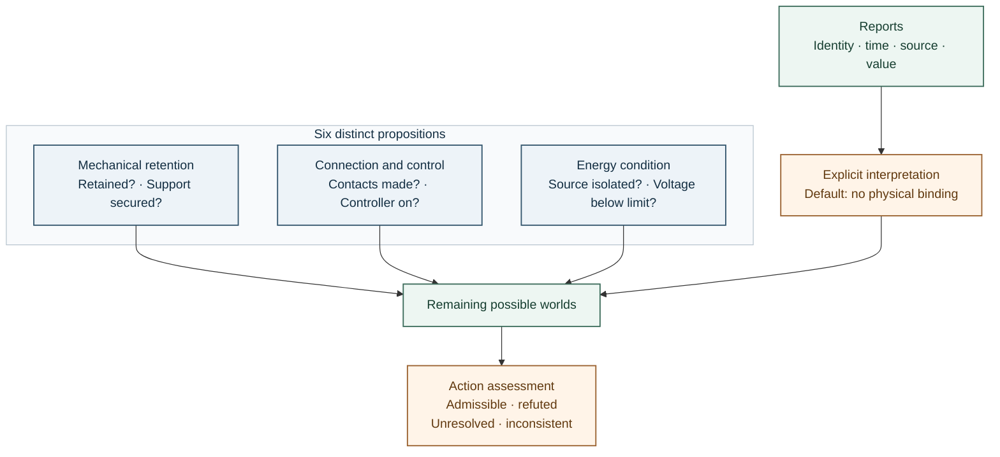
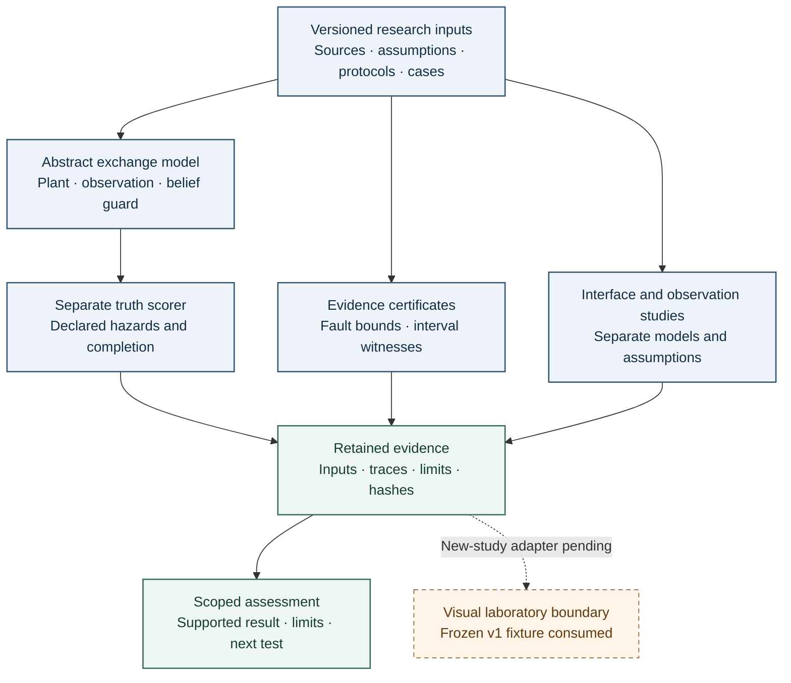
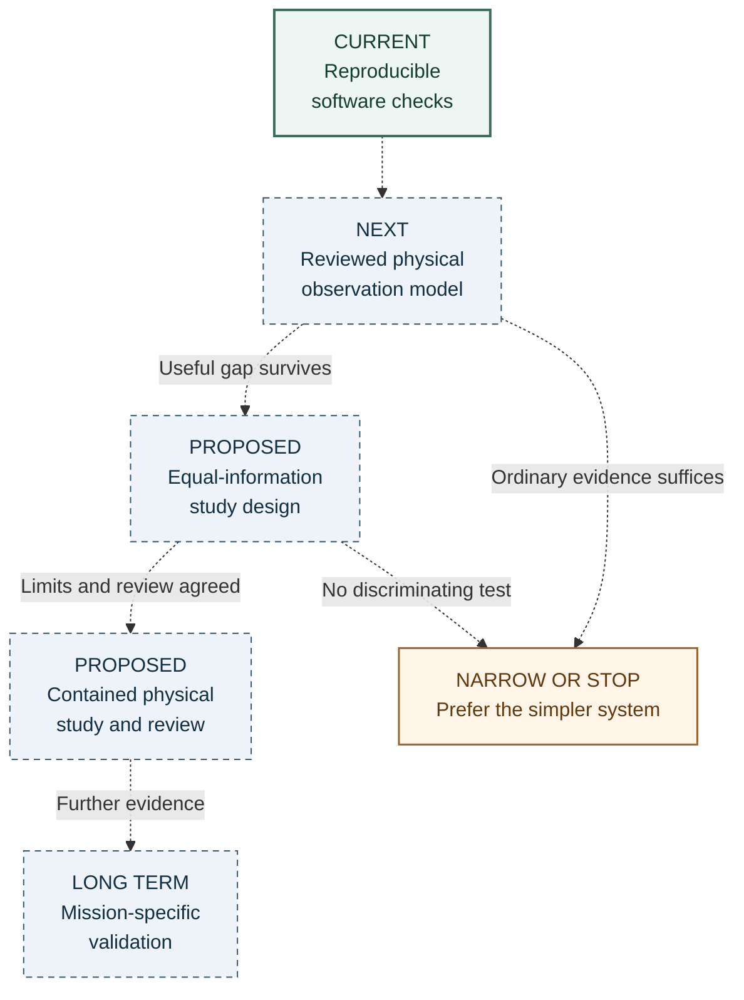

# CARTAN

CARTAN is a research program for robotic spacecraft maintenance. Its first
investigation asks what a servicing system can establish about a prepared module
after an exchange is interrupted, and what evidence is needed before it moves again.

The long-term aim is spacecraft and orbital infrastructure that can be repaired,
upgraded and reconfigured. The immediate problem is smaller: determine whether a
module is retained, whether its contacts can be separated, and whether uncertainty
can be resolved within the available time and resources.

This repository contains research specifications, executable models and retained
software studies. It does not yet establish physical recovery performance or
flight capability. The current results support a careful observation model and
show where simpler methods already give the same answer.

[Current findings](research/block-4/results.md),
[physical observation model](research/block-4/specification.md),
[primary sources](research/block-4/sources.md),
[recovery prior art](research/block-4/source-followup.md), and
[first experiment](research/experiments/first-study.md).

## The interrupted exchange

A capture request is acknowledged. The operation stops before completion is
independently established. The module might be retained, partially captured, or
supported only by the servicing device. Repeating a command may help, change the
state, or leave the same uncertainty. Releasing support and separating electrical
contacts require evidence about different physical conditions.

The controller's report is one part of that evidence. A drivetrain position needs
a justified relationship to engagement; engagement needs a qualified relationship
to load capacity. A voltage reading refers to a particular terminal pair and time.
It cannot by itself establish that every source is disconnected.

The model therefore keeps six propositions distinct.



The central hypothesis is that explicit uncertainty can improve recovery when
ordinary sensing, interlocks and competent procedures leave a consequential
ambiguity. The first obligation is to establish that such an ambiguity exists.
An inexpensive sensor, a passive interlock, an operator procedure or a conventional
state machine may resolve it more effectively.

## Architecture

Physical truth, observations, commands and inferred belief have separate roles.
Missing, unknown, unmeasured and null values remain distinct from known zero or
false. Each study records its assumptions and keeps the attempted cases, including
contradictions and failures.

Four modules currently address separate questions. The abstract exchange model
exercises guarded transitions and separate truth scoring. The certificate module
examines bounded report errors, set intersections and a scalar electrical envelope.
The interface evaluator checks declared actions over possible logical worlds.
The observation module calculates conditional voltage bounds and source
connectivity. They are separate offline studies, not a combined recovery controller.



The interface evaluator returns admissible when every remaining world satisfies
an action's declared predicate, refuted when none does, and unresolved when both
possibilities remain. An empty set is inconsistent. Mixed results include a witness
for each possibility, so a reader can inspect why the decision remains open.

A decision can be justified within a model without identifying every variable.
A consistent belief can also be wrong if its assumptions exclude reality.
The current models always retain physical authorization as not assessed.

The observation module now identifies the quantity, sensing point, acquisition
time and assumed uncertainty behind a reading. Its voltage calculation includes
gain, bias, residual error and change between acquisition and decision. A separate
graph calculation checks alternate source paths. It preserves missing calibration
and incomplete source inventories as unresolved conditions.

The [interface dossier](backend/observation_model/interface-profile.json) uses
public design information to identify the remaining physical obligations. The
[latest source review](research/block-4/sources.md) distinguishes documented
relationships from unverified calibration, fault coverage and current hardware
applicability. No numerical cam profile or qualified retention limit is supplied
by the software.

## Findings

The following studies were completed locally on 16 November 2026. Their cases are
disclosed software checks, not independent physical trials or reliability samples.

The [abstract exchange study](research/results.md) retained 15 scenarios and 27
toy sensitivity points. Its separate scorer detected five deliberately hazardous
cases. Completing the task did not erase an earlier hazard.

The [equal-information study](research/block-2/results.md) compared simple counting
with an explicit observer over 42 histories and 186 prefixes. They agreed throughout.
The proposed observer had no algorithmic advantage in that bounded-error binary
problem. That result shifted the priority toward the meaning and sufficiency of
observations before increasing planner complexity.

The [conditional certificate study](research/block-2/mathematics.md) checked six
interval cases and nine normalized electrical envelopes. Zero overlap volume did
not imply disjoint sets. Under an allowed backfeed floor, waiting alone could not
produce a finite voltage-limit certificate. Those bounds were assumed model
parameters, not measured circuit values or operational waiting instructions.

The [interface study](research/block-3/results.md) retained 21 cases, 256 complete
world/action comparisons and 11 boundary tests. It preserved separate interface
facts, acquisition identity, stale-data exclusions and unresolved or inconsistent
outcomes. Its simplified predicates still omit physical conditions needed for
real action.

The [observation study](research/block-4/results.md) retained 34 cases and passed
11 boundary tests. Eight numerical voltage cases matched a conventional exact
calculation; 269 topology assignments matched an independent reference. Possible
backfeed and incomplete source inventories prevented unwarranted isolation
conclusions. These are constructed checks of the model, not observed vendor faults.

Each study has an identical-core replay with matching input hashes. A replay
establishes repeatability of the recorded computation, not independent scientific
replication. Recovery time, safety benefit, mass, power and economic advantage
remain unmeasured. Hardware and flight validation are separate obligations.

## The next experiment

Select one documented interface revision and establish whether a reachable,
decision-relevant ambiguity survives its ordinary sensing, interlocks and recovery
procedures. Use independent truth instrumentation and containment. A dangerous
baseline event is not required. If the existing procedure establishes the decision
within the reviewed hold limit, retain that result and narrow the added inference work.

A surviving gap would justify the [recovery comparison](research/experiments/first-study.md).
B0 is an engineered interlocked state machine with bounded rereading, retries and
recovery. B1 is a trained operator using the reviewed procedure. B2 adds an
independent measurement or passive change. C is explicit possible-state recovery.
N retains support and holds or abandons the task within the agreed limits.
Algorithm comparisons receive the same information. Hardware changes carry their
full integration and lifecycle burden.



Safety outcomes, verified recovery, safe aborts, unresolved cases, interventions,
elapsed time and system burden are measured separately. An abort remains in the
completion denominator. Active diagnostics require their own resulting trajectories;
one controller's observations cannot stand in for another controller's actions.

The [physical validation plan](research/block-4/specification.md) separates
calibration from validation conditions and includes acquisition timing, shared
causes, drift and the measurement's operating domain. Current unit documentation,
qualified physical relationships and owner-backed limits remain missing.
The [additional source review](research/block-4/source-followup.md) identifies
existing interruption, counterpart-release and interoperability studies. Those
capabilities belong in the baseline; CARTAN has not established a novelty claim.
The [roadmap](research/ROADMAP.md) identifies the evidence needed to proceed.

## Reproduction

The backend runs with Python 3.11+ and the standard library, without a service or
package installation. From the research checkout, use a new directory for each run.

```sh
python3 -B -m unittest discover -s backend/observation_model -v
python3 -B backend/observation_model/run_study.py --output /private/tmp/cartan-observation-first
python3 -B backend/observation_model/run_study.py --output /private/tmp/cartan-observation-replay
cmp /private/tmp/cartan-observation-first/core.json /private/tmp/cartan-observation-replay/core.json
```

Compare input hashes as well as core bytes. The summaries record resource use,
measurement scope and whether requested limits were supported. Earlier commands
remain in the [exchange](backend/README.md),
[certificate](backend/certificates/README.md) and
[interface](backend/interface_evidence/README.md) module documentation. Their
source and evidence remain frozen.

## Research record

The [initial audit](research/current-state.md) and [first source ledger](research/sources.md)
record the packet discrepancies. [Block 2](research/block-2/sources.md) and
[block 4](research/block-4/sources.md) recover additional primary material and
correct earlier access gaps. The review is targeted; it is not a claim of
exhaustive coverage or institutional endorsement.

Architecture decisions [001](research/decisions/ADR-001.md),
[002](research/decisions/ADR-002.md), [003](research/decisions/ADR-003.md) and
[004](research/decisions/ADR-004.md) precede their implementation blocks.
[Retained evidence](research/evidence/) includes full cases, witnesses,
input/output hashes and execution receipts. Memory helps locate those records;
it is not independent evidence.

The [visual laboratory](frontend/README.md) consumes the [frozen v1 contract](contracts/cartan/v1/README.md).
Its imagery illustrates a concept and its canonical fixture is synthetic. Newer
analytical studies require a reviewed adapter. Research and UI use separate
worktrees, and setup owns launch configuration. The [handoff](docs/SESSION_HANDOFF.md)
and [coordination record](docs/COORDINATION.md) identify current ownership and
continuation rules. The [diagram review](docs/qa/readme-20261116/revision-02/REVIEW.md) retains
rendered copies for readers whose Markdown viewer does not support Mermaid.

## Local operation

The [operating guide](docs/SESSION-OPERATIONS.md) records setup's approved launch,
resume and continuity behavior. Daniel selected full access / YOLO on 16 November
2026. The installed canonical launcher supplies runtime overrides; historical
client snapshots do not describe that effective mode. Setup retains ownership of
launchers, MCP and global configuration.

```sh
cartancodes --check            # local preflight; starts no model
cartancodes resume --check     # inspect the research resume plan
```

The canonical `cartan-codex` and `cartan-claude` names and compatibility aliases
accept lane, resume and check arguments. See the operating guide for actual
session entry, authentication, version checks and continuity. Integration does
not restart or reconfigure an existing session.

## License

Original CARTAN code, documentation, synthetic fixtures and research output are
available under [Apache-2.0](LICENSE), copyright 2026 Daniel Wahnich. Supplied
concept media, brand assets and third-party works retain separate rights.
[Licensing scope and attribution](LICENSING.md) explains the boundary.
