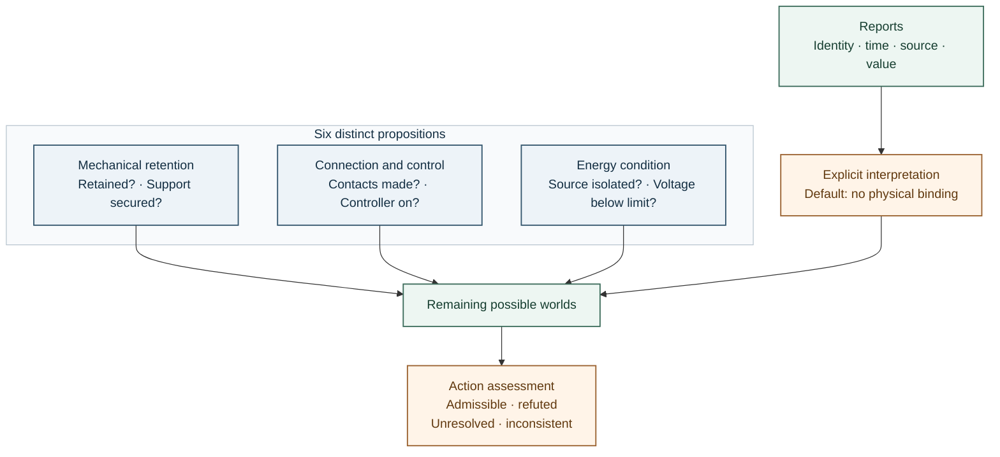
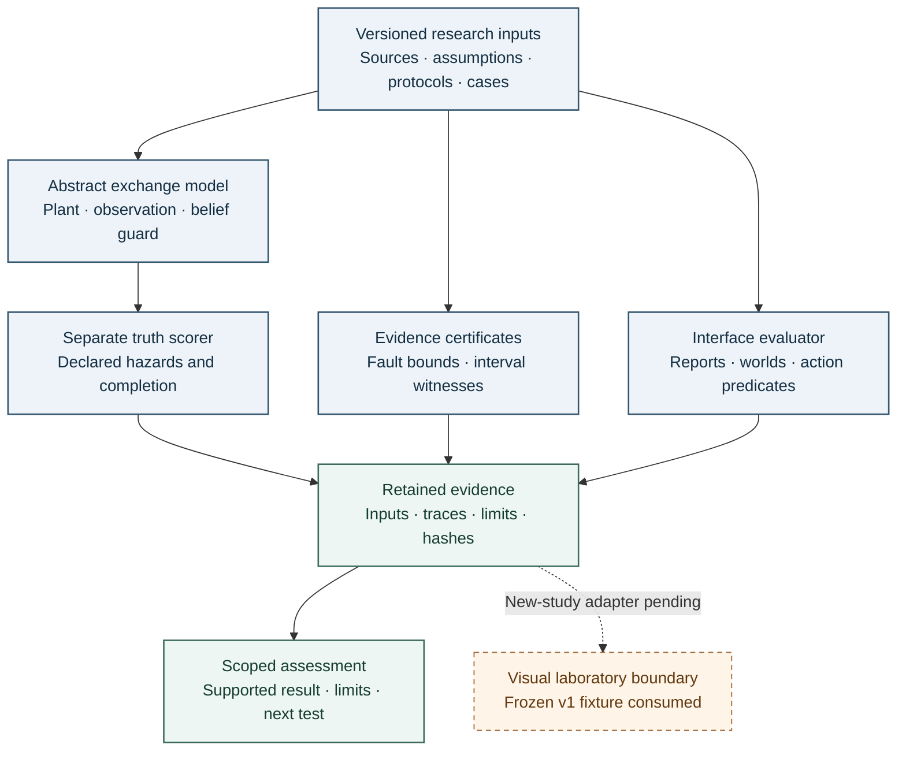
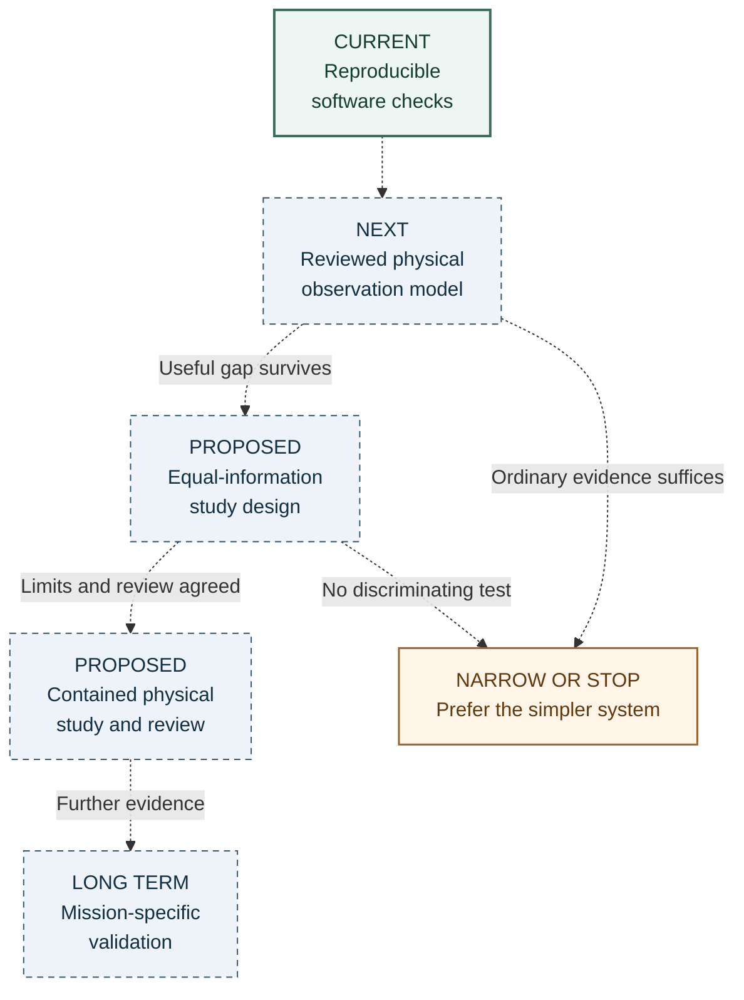

# CARTAN

**Recoverable service for spacecraft.**

CARTAN investigates how a robotic servicing system can establish mechanical
retention and electrical isolation after an interrupted operation. Its first
problem is the exchange of a prepared module: an operation has stopped, reports
may be incomplete, and the next action depends on facts the controller cannot
directly observe.

The long-term aim is spacecraft and orbital infrastructure designed for repair,
upgrade and reconfiguration. The work here begins with one decision at one
interface. CARTAN currently contains research specifications, small executable
models and reproducible software studies. Physical recovery performance and flight
capability remain unestablished.

[Current findings](research/block-3/results.md) ·
[Architecture decisions](research/decisions/ADR-003.md) ·
[Primary sources](research/block-2/sources.md) ·
[First discriminating experiment](research/experiments/first-study.md)

## The interrupted exchange

A capture request is acknowledged. The operation stops before completion is
independently established. The module might be retained, partially captured, or
supported only by the servicing device. Repeating the command may help, change
the state, or leave the same uncertainty. Before releasing support or separating
contacts, the system needs evidence for the particular action it proposes.

A command acknowledgement, a mechanism position and a qualified load path are
different things. So are controller power, electrical contact, source isolation
and residual voltage. Public preliminary HOTDOCK documentation makes several of
these distinctions explicit; it provides useful interface context, but no
calibrated CARTAN observation model. [Source and scope](research/block-2/sources.md).



The central hypothesis is conditional: **explicit uncertainty may improve recovery
when ordinary sensing, interlocks and competent procedures leave a consequential
ambiguity.** The first obligation is to establish that such an ambiguity exists
and matters. An inexpensive sensor, a passive interlock, an operator procedure or
a conventional state machine may be the better solution.

## What the engine does

The research engine separates physical truth, observations, commands and inferred
belief. It keeps missing, unknown, unmeasured and null values distinct from known
zero or false. Each study declares its assumptions and preserves attempted cases,
including contradictions and failures.

Three small modules address different questions. They have separate specifications
and retained outputs; they are not yet a combined recovery controller.



The [interface evaluator](backend/interface_evidence/README.md) checks a declared
action predicate against every remaining logical world. It returns:

| Result | Meaning within the declared model |
|---|---|
| `admissible` | Every remaining world satisfies the predicate. |
| `refuted` | No remaining world satisfies it. |
| `unresolved` | Both satisfying and violating worlds remain; retain a witness of each. |
| `inconsistent` | No world remains; the input/model combination cannot justify a decision. |

An action can be decidable without identifying every variable. Conversely, a
consistent belief can still be wrong if its fault assumptions exclude reality.
Every current evaluator result carries `physical_authorization: not_assessed`.
The six-proposition domain and command predicates are deliberately incomplete
physical models; load paths, geometry, contact limits and observation calibration
remain engineering obligations.

## Evidence so far

Local studies completed on 16 November 2026. These counts describe disclosed
software checks, not independent physical trials or estimates of reliability.

| Study | Retained result | What it establishes |
|---|---|---|
| [Abstract exchange](research/results.md) | 15 scenarios, 27 toy sensitivity points; five deliberately hazardous cases detected | The separate scorer detects the declared hazards in the restricted model. Completion does not erase an earlier hazard. |
| [Equal-information observation](research/block-2/results.md) | Simple counting and the explicit observer agree on all 42 histories and 186 prefixes | No algorithmic advantage in this bounded-error binary subproblem. Retire that proposed differentiator. |
| [Conditional certificates](research/block-2/mathematics.md) | Six interval checks; nine normalized electrical envelopes | Zero overlap volume need not mean disjoint sets. A possible backfeed floor can prevent a finite passive-wait certificate. |
| [Interface evidence](research/block-3/results.md) | 21 cases; 256 reference classifications; 11 boundary tests | Distinct interface facts, report provenance and unresolved/inconsistent outcomes survive the declared software checks. |

Each study has an identical-core replay with matching input hashes. A replay checks
reproducibility, not independent replication. No measured recovery-time, safety,
mass, power or cost advantage has been established. The studies have not validated
hardware, an operational interface or a flight system.

The strongest direction change came from a null result: a competent conventional
method matched the explicit observer when both received the same information.
That moves the next priority toward the physical meaning and sufficiency of
observations, before increasing planner complexity.

## The next experiment

First establish one reachable, decision-relevant ambiguity on a documented
interface revision. Preserve ordinary sensing, interlocks and recovery procedures.
Use independent truth instrumentation and containment; an unsafe baseline event
is not required. If ordinary evidence already resolves the decision within the
reviewed hold limit, record that result and narrow or stop the added inference work.

Only a surviving gap warrants the recovery comparison in the
[first-study protocol](research/experiments/first-study.md): an engineered
interlocked state machine (**B0**), a trained operator (**B1**), additional sensing
or a passive change (**B2**), explicit possible-state recovery (**C**), and a
hold/abandon arm (**N**). Attribute algorithmic gains only under matched information.
Compare hardware changes with their full integration and lifecycle burden.



Measure safety outcomes, verified recovery, safe aborts, unresolved cases,
interventions, elapsed time and system burden separately. An abort stays in the
completion denominator. Active diagnostics require their own resulting trajectories;
one controller's observations cannot stand in for another controller's actions.
Owner-backed limits, calibration and a qualified review are still missing. The
[prioritized roadmap](research/ROADMAP.md) records the evidence needed at each gate.

## Reproduce the current slice

The backend uses Python 3.11+ and the standard library. It starts no service and
requires no package installation. Run from this research checkout; each output
directory must be new.

```sh
python3 -B -m unittest discover -s backend/interface_evidence -p 'test_*.py' -v
python3 -B backend/interface_evidence/run_analysis.py --output /private/tmp/cartan-interface-first
python3 -B backend/interface_evidence/run_analysis.py --output /private/tmp/cartan-interface-replay
cmp /private/tmp/cartan-interface-first/core.json /private/tmp/cartan-interface-replay/core.json
```

Inspect the summaries and compare input hashes as well as the cores. The runner
records resource limits and their enforcement status. See the
[exchange-model instructions](backend/README.md) and
[certificate instructions](backend/certificates/README.md) for earlier studies.
Their artifacts remain frozen.

## Navigate the work

| Location | Responsibility |
|---|---|
| [Research audit](research/current-state.md) and [source ledgers](research/sources.md) | Packet discrepancies, primary-source scope and missing material; [later source recovery](research/block-2/sources.md) corrects earlier access gaps. |
| [ADR 001](research/decisions/ADR-001.md), [002](research/decisions/ADR-002.md), [003](research/decisions/ADR-003.md) | Decisions and alternatives, recorded before their implementation blocks. |
| [Retained evidence](research/evidence/) | Full constructed cases, witnesses, input/output hashes, failures and execution receipts. |
| [Frozen contract v1](contracts/cartan/v1/README.md) | Versioned research/UI boundary; the canonical fixture is synthetic and is not evidence. |
| [Session handoff](docs/SESSION_HANDOFF.md) and [coordination](docs/COORDINATION.md) | Current commits, ownership, setup provenance and continuation rules. |

Research and the visual laboratory occupy separate Git worktrees. UI consumes
committed, versioned contracts; its concept imagery and fixtures do not establish
scientific results. Newer analytical records need a reviewed adapter before UI
integration. Setup owns launch configuration. Use the CARTAN launcher and the
current handoff when resuming work; historical setup checks are not current
authentication or runtime guarantees.

[Diagram renders and presentation checks](docs/qa/readme-20261116/REVIEW.md).
