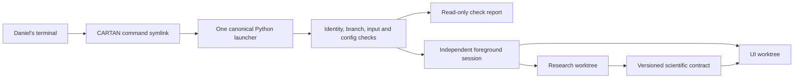

# CARTAN environment architecture and local audit

Date: 16 November 2026. Owner: the existing setup session. Scope: read-only
inspection of established launch architecture, followed by additive CARTAN setup.
No existing project launchers, credentials, active sessions or research originals
were intentionally changed. See `VERIFICATION.md` for executed checks and limits.
The subsequent comparison and resume improvement are recorded in
`SETUP-COMPARISON-2026-11-16.md`. Follow canonical `SESSION-OPERATIONS.md` for
current launch/resume behavior; active lane setup snapshots can be older.

## Discovery and provenance

The session began in `/Users/danielwahnich/Projects/daniel-portfolio`, whose Git
root and origin matched that project. Daniel explicitly requested continuation
here for CARTAN setup, so no portfolio bootstrap or project edit was performed.
The CARTAN packet is an input folder, not a checkout.

Inspected immediate workspace/project roots; searched names through three levels
of the home directory excluding Library, caches, dependency trees and Git
internals; inspected user config project registries and latest 50 Codex task
titles. No CARTAN checkout or competing setup root was found in that bounded
scope. This is not a claim that every volume and historical archive was searched.
The only CARTAN task title found in that list was the current setup task. No
other task was resumed, messaged, renamed, stopped or archived.

The new canonical local repository is `~/workspace/cartan`. No origin, private
GitHub repository, hosting project or cloud resource was created. The source
packet's twelve controlling inputs are hash-bound in `config/inputs.json`.
Both November 15 PDFs match v3's SHA-256 values; text was extracted for reading.
This setup pass does not certify their visual design or scientific content.

A candidate `cartan-original-logo.png` was found in
`~/Documents/CARTAN-Email-2026-11-15/CARTAN-Email-Identity/`. Its filename is not
proof of approval, currentness or usage rights. It was not imported into CARTAN.
The complete Gemini exchange, original-paper archive, restricted interface
manuals, editable geometry, film masters and full historical investigations are
still not established as recovered. UI/research sessions own the deeper intake.

## Actual launcher and shell precedence

Read `.zshenv`, `.zprofile`, `.zshrc`, the named executable targets, sourced
operator definitions and relevant project configuration before invoking any
diagnostic path. No project launcher or project bootstrap was executed during
the survey. In a fresh interactive login zsh, `whence -va` established:

| Project | Actual entry points and resolution | What execution actually does | Retain / improve |
|---|---|---|---|
| Sentinel | `sentinelcodes` / `sentinelclaudes`: shell aliases to absolute symlinks, both targeting `~/.local/bin/sentinel-launcher`; singular `sentinelcodex`/`sentinelclaude` functions delegate there | Checks directory, changes to `~/workspace/sentinel`, starts client with permission bypasses; Codex also hook-trust bypass and live search | Shell's richer `_sentinel_preflight` is used by `sentinelstate`, **not** the launch path. Put one real guard in the executable; avoid a reassuring unused preflight |
| Nisayon | `nisayoncodes` / `nisayonclaudes` symlink to `workspace/nisayon/scripts/launch.py` | Resolves canonical root from script; `--workspace` verifies marker and common Git directory; `--print-config` returns before install/exec; actual launch may run `uv sync --frozen` if venv missing | Retain common-Git identity and explicit argv; separate install from launch; do not copy product MCP, model/effort defaults or bypasses |
| Nisayon CLI/MCP | `nisayon` / `nisayon-mcp` symlink to `scripts/entry.py` | Searches cwd/ancestors for marker until Git boundary; falls back to canonical; execs lane venv module | Useful lane-local context; silent canonical fallback would be undesirable for CARTAN writes |
| Reiyah engine | `reiyahcodes` alias → `reiyahcodexfull` → `reiyahcodex`; Claude equivalent functions in `.zshrc` | Preflight can mkdir/init Git; checks root and optional remote, with an environment override; reports branch/dirty state and continuity; Claude attaches quarantine; both bypass permissions, Codex bypasses hook trust | Retain identity and state visibility, but split bootstrap from preflight; never describe added directories as technically read-only because prose says so |
| Odeya | `.zshrc` aliases → full functions | Checks `.git` directory; enumerates ecosystem paths; Claude attaches siblings; both bypass permissions; Codex bypasses hooks | Preserve ecosystem distinctions; CARTAN does not inherit those attachments or authority |
| Etzio | Standalone executables plus compatibility symlinks | Validates exact root, accepted origin and required AGENTS/handoff; Codex can source nvm if missing, has resume variant; Claude adds project prompt; bypasses remain | Retain fail-closed identity checks, safe argv and no secret dumps; remove automatic runtime changes and bypasses for CARTAN |
| Artemis | Standalone launchers and symlink aliases | Root/remote/instruction checks, Node activation, wrapper preflight; Claude strict Notion config; Codex selects `artemis` profile and strict config; both bypass permissions | Clear prerequisites are useful. Do not execute preflight without auditing its effects. Current global Codex config has no inline profiles; current CLI profiles are separate files. Notion credentials/services do not belong to CARTAN |
| Daniel portfolio | `.zshrc` aliases `danielcodes`/`danielclaudes` choose full variants | Root/origin/release-guard checks. Singular `danielcodex` uses workspace-write/on-request; full alias bypasses both and hook trust | Safer singular mode exists but the familiar plural alias changes security meaning. CARTAN spellings have identical semantics |
| Aweb | `.zshrc` functions; `aweb` itself is overridden by a later executable alias | Client preflight runs context, MCP inspection, validation, trader status and stdio smoke commands, writing `/tmp` snapshots | Launch diagnostics can have effects. CARTAN dry-run neither runs product preflight nor starts adapters |
| ATLAS | Absolute aliases → symlinked `workspace/atlas/scripts/launch.py` | Exact root/required-file checks, filtered Git environment, safe `--atlas-check`; disables Aweb/email, uses no-daemon; full access remains | Retain read-only check, sanitized Git context and no-daemon. Inspected only; never reopened |

The recalled `sentinel-codex` and `sentinel-claudes` names do not resolve.
Reiyah and Odeya aliases depend on interactive shell startup; Nisayon and
standalone executables work without it. The last PATH prepend in `.zshrc`
puts `~/.local/bin` first, then the Node 20.18.3 bin. PATH contains repeated
entries from shell startup; no cleanup was attempted. `.zprofile` invokes
Homebrew shellenv twice and loads nvm; `.zshrc` loads nvm again. These are
maintenance candidates, not changes authorized in this setup.

Codex resolves to `~/.local/bin/codex`, a symlink to the Node package launcher.
Claude resolves to `~/.local/bin/claude`, a symlink to native version 2.1.302.
Installed versions: Codex 0.169.0; Claude Code 2.1.302; the inspected Python is
Homebrew Python 3.14.2. The launcher requires Python 3.11+ and standard library
only. Client version drift deliberately requires rechecking supported flags.

## Context, memory and hooks

Global Codex `AGENTS.md` supplies identity gates and project-routing exceptions.
Global Claude `CLAUDE.md` supplies machine conventions; some are older than the
current CARTAN prompts. CARTAN's instructions explicitly preserve the latest
operator's fixture permission and prevent unrelated Google/deployment bootstrap.

Sentinel uses AGENTS → CONTINUITY → HANDOFF → machine mission state. Reiyah and
Etzio have large historical handoffs and explicit evidence gates. Nisayon's
shared `memory/INDEX.md`, append-only notes, per-session checkpoints and branch-
local records are useful conventions. Its SessionStart/PreCompact/Stop/SessionEnd
hooks write ignored mechanical snapshots; its own modules and writable memory MCP
are not imported. Global Codex memories and native Claude project memory are
discovery aids, never new CARTAN evidence or another lane's integration authority.

Installed Codex browser/chrome plugins call `node_repl.turn_ended`; unified
computer-use calls `cua_repl.turn_ended` on Stop/Interrupt/SubagentStop. Disabling
their servers would impair cleanup. These existing adapters and hook trust flow
are preserved, with no dangerous hook flag. No new hook or background daemon is
installed. Browser capabilities may therefore exist; unrelated application or
account actions remain outside task authority. Their runtime bridge connection
has not been demonstrated by this setup check.

## MCP inventory and intended scope

| Server / surface | Scope and startup | Credential source (never values) | CARTAN disposition |
|---|---|---|---|
| `openaiDeveloperDocs` | Existing global Codex HTTP endpoint `https://developers.openai.com/mcp`; explicit Claude HTTP config | Public service, no credential configured | Read-only documentation; existing connected tool succeeded. Future client discovery still untested |
| `aweb` | Global Codex pnpm/tsx stdio bridge into Aweb; portfolio Claude also supplies config | Aweb's own bridge/provider configuration; actor and enable flags in MCP env | Disabled for CARTAN; no credential files sourced or copied; no Aweb startup |
| `odeya-email-department` | Global Codex Node stdio script from personal plugin | Department-managed account/provider path; no credential printed or inspected | Disabled; no correspondence authority |
| `daniel-research-google` | Global Python stdio adapter; inspected source fixes account/project and offers two read-only status/lookup tools | Existing gcloud account store, access token obtained only inside adapter calls | Disabled initially; not a paper-research API, not a spending budget; no Google live check or scope change |
| `node_repl` | Global app-bundled executable, existing browser bridge environment | Native app/session/browser state, not a project secret | Retained for existing cleanup hooks; connection and UI capability not tested |
| `cua_repl` | Installed unified computer-use plugin | Existing native bridge/app/browser authorization | Retained for cleanup hooks; not proof of browser availability or action authority |
| `computer-use` | Legacy global executable entry already disabled | Native macOS permissions | Remains disabled |
| `codex_app` / connected apps | Plugin/app runtime; effective native MCP inspection | Existing connected-account OAuth | Disabled by CARTAN app defaults; no new connectors |
| Nisayon | Project `uv run --frozen --offline nisayon-mcp` in `.mcp.json` and `.codex/config.toml` | Local project files; no separate auth for memory tools | Not attached; do not write sibling memory |
| Artemis Notion | Project shell/npx config and separate wrappers/private config | `~/.config/artemis/notion.env` and wrapper-managed credentials, contents not read | Not attached; no install, preflight or token reuse |
| Claude user/project/plugin MCP | User/local/project registries and installed plugins | Existing Claude store/connectors | `--strict-mcp-config` selects only CARTAN docs; child environment opts out of claude.ai connectors; no Chrome integration requested |

No new third-party MCP package, memory database, paid research server or credential
was created. Native client account login is distinct from every service's auth.
Codex reports stored ChatGPT login. Claude reports `loggedIn=false`. Neither
proves remote model entitlement/quota. The setup never refreshes or creates auth.

## CARTAN architecture and authority boundaries

Canonical implementation belongs to setup; four names resolve to the same file.
`cartancodes` defaults to research; `cartancodes ui` chooses the other worktree.
Claude spellings have the same lane grammar. Arbitrary client flags and prompts
are rejected, including permission/config overrides. Unknown arguments are not
echoed. The launcher checks exact root/common Git identity, expected branch,
remote policy, required instructions, byte equality of setup-owned lane config,
input hashes, executable and client version. Dirty work is reported, never reset.

`--check` reads files, invokes local Git inspection and `--version`, and checks
local authentication status. Codex also parses the effective native MCP config.
Authentication/config diagnostics run with OS network denial; no MCP server,
model, install, hook or daemon is started. Missing auth returns exit 2 with the
rest of the local plan still reviewable. Real launches
require Daniel's interactive terminal, refuse known nested-agent environments,
and open independent foreground clients. Multiple terminals may select the same
lane. The initial single-session lock was removed at Daniel's request on
16 November 2026; no existing process or lock file was touched. Installed command
symlinks use the canonical launcher, so branch-local launcher snapshots need not
be rewritten in active worktrees. Other setup configuration equality checks remain.

| Dimension | Configuration / limitation |
|---|---|
| Filesystem | Codex workspace-write in the selected lane, no additional write roots. Claude Bash sandbox enabled, unavailable sandbox fails closed, unsandboxed retries disabled. Read access can exceed the lane; these are not per-file confidentiality sandboxes |
| Approvals | Codex on-request; Claude manual with ask rules. No auto-review, bypass or auto-trust introduced. Existing managed/user policy and hooks remain loaded |
| Network | Codex shell network remains disabled. Claude retains network approval controls. No host networking, proxy, firewall or machine setting changed. Hosted web tools, model transport and MCP are separate from shell networking |
| Credentials | Child receives a small terminal/proxy/certificate environment allowlist. API keys, cloud variables, shell injection variables and Git routing overrides are not forwarded. Existing client credential stores remain in place. No account copying or automatic login |
| MCP | Explicit project docs config plus existing Codex lifecycle adapters; no sibling-product services. A connected tool may still have broad OS/account capabilities, which the task does not authorize |
| Hooks | No hooks disabled or auto-trusted. Existing cleanup server dependencies retained. Future runtime hook operation remains untested without a session |
| Paid services | No job, inference test, generation or cloud spend. Local auth and reachable APIs are not a budget |

The launcher reads the actual current user MCP config to disable unrelated names;
unexpected identifiers requiring ambiguous CLI syntax fail closed. The public
docs entry must remain at the audited endpoint without additional command or
credential fields. New plugins/managed policy can change availability; native
inspection and the live session's tools must be checked after upgrades. Codex's
native offline inspection runs on every preflight and rejects an unexpected
enabled MCP set; the interactive settings in Claude still require first-session
verification, since its `mcp list` does not load the launch-only config.

## Maintenance and remaining decisions

One integration owner; separate branches; source-bound contract handoffs; no
automatic shared-memory writes. This is deliberately a small setup architecture.
The research/UI architecture must follow source reading and an explicit ADR,
not a speculative framework selection during environment preparation.

Reinstall command names with `python3 scripts/install_launchers.py`; it refuses
collisions and never overwrites an existing file. `--check` verifies installation.
No existing files were replaced, so no secret-bearing backup was needed.
`~/Documents/CARTAN-Environment-Setup-2026-11-16/preservation-before.json` holds
hash-only preservation records for inspected existing launch/config/input files.
Git retains CARTAN revisions. Rollback consists of removing only symlinks that
still point to this launcher; preserve the repo and worktrees for review. No
automatic deletion script is provided, and no user history is rewritten.

Pending decisions: remote and visibility; additional service needs and exact
scopes; model/effort preference (currently inherited, no arbitrary paid-model
choice); bounded compute budget; research contract and implementation stack;
UI asset approvals and browser QA. Do not update a pin, input hash or guard just
to pass a check. Re-audit the changed assumption first.

Official behavior references checked for this setup:

- [Codex configuration precedence](https://learn.chatgpt.com/docs/config-file/config-basic)
  and [configuration reference](https://learn.chatgpt.com/docs/config-file/config-reference).
  Installed CLI help is the authority for its accepted flags.
- [Claude settings](https://code.claude.com/docs/en/settings-reference),
  [sandboxing](https://code.claude.com/docs/en/sandboxing), and
  [MCP scope](https://code.claude.com/docs/en/mcp).
  Installed 2.1.302 predates some current docs defaults, so safety-relevant values
  are explicit. These sources do not prove a live session was exercised.
