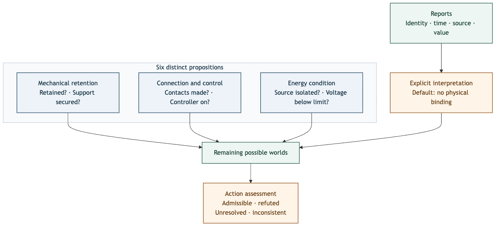
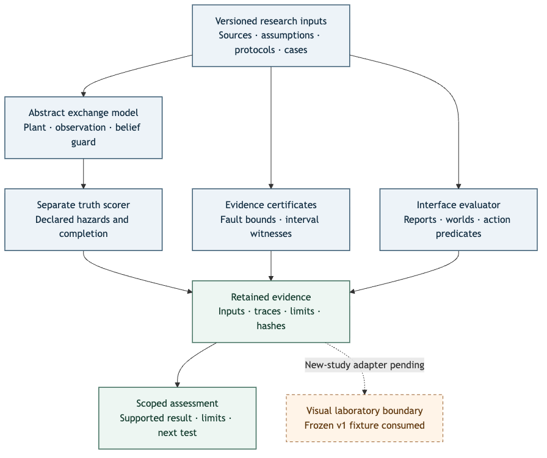
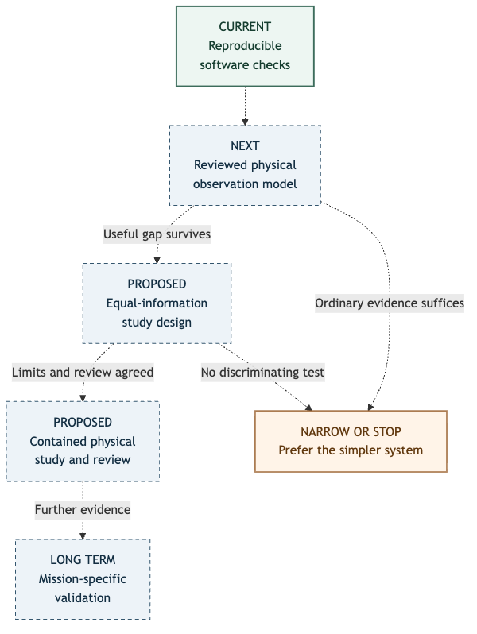

# README diagram review — 16 November 2026

Owner: research. Scope: presentation of the root README, explicitly requested by
the operator. These pictures explain the program; they are not research results,
physical observations or validation evidence.

All three final Mermaid sources were rendered with installed CLI 11.4.2 and Node
20.18.3, using the existing Chrome browser with a temporary headless profile. The
rendered PNGs were visually inspected for clipping, readable labels, crossings,
decision meaning and distinction between implemented and proposed work. The
[receipt](presentation-receipt.json) binds sources, PNGs and the exact README by
hash. `.mmd` files here are retained QA snapshots; edit the README's source blocks.

An initial render failed because Puppeteer's bundled Chrome was absent. No browser
was installed. The existing Chrome executable was used through approved execution.
The first successful diagram-1 render revealed a clipped group title; it was
shortened and rendered again. Diagram 3's initial horizontal layout made labels
too small; it was changed to vertical. Its final labels distinguish a proposed
study design from a physical outcome and put review/limits before physical work.
All final labels were readable in local inspection; no clipping was observed.

Six successful render invocations ran sequentially, each with a 60-second process
timeout; none timed out. Retained JSON logs include the original layouts' resource
observations. Successful observed wall time ranged from 1.78 to 6.21 seconds.
`time -l` reported maximum resident size between 251,314,176 and 289,161,216 bytes.
Those command observations do not establish a total browser-process memory cap.
The renderer's occasional ZenUML startup warning did not prevent the flowchart
renders; its text remains in the logs. Backend evaluation ran separately.

Each diagram has `accTitle` and `accDescr`; status is also carried by words and
line styles, not color alone. The source uses established flowchart syntax.
Documentation consulted: [Mermaid accessibility](https://mermaid.js.org/config/accessibility),
[flowcharts](https://mermaid.js.org/syntax/flowchart), and
[GitHub diagrams](https://docs.github.com/en/get-started/writing-on-github/working-with-advanced-formatting/creating-diagrams).
Actual screen-reader use, mobile native rendering and GitHub's renderer were not
tested. No remote exists for a live GitHub preview. These PNGs provide a static
reading option when a Markdown viewer lacks Mermaid support.

## Distinct interface facts

## Implemented research modules

## Evidence gates

