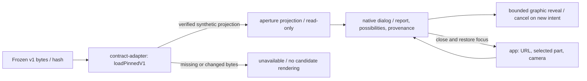

# UI 010 — the evidence aperture

23 November 2026. Decision before implementation. Daniel explicitly asks this
session to develop CARTAN's interaction and visual design, learning from Reiyah's
receipt reveal without copying its organism/DNA language. This authorizes frontend
work in this owned CARTAN checkout; it does not transfer the sibling checkout,
setup configuration, scientific contracts or website deployment.

## Inspected state and boundary

Base `382f3a0632814025e1ece602a18bc5a597cd5db4`, clean
`research/architecture`, shared CARTAN Git common directory. The earlier complete
repository reconstruction is in `research/decisions/RETENTION-2026-11-23.md`.
For this slice inspected the actual route/URL owner, app callers, spatial geometry,
WebGL/SVG consumers, contract adapter, focus/media controllers, source HTML/CSS,
release builder/verifier, presentation/state/geometry/lifecycle tests, DOM harness,
UI 007 decision/map and integration browser receipts. Generated static releases,
retained QA patches/media and the frozen vendor contract are identified artifacts,
not new sources of authority. No source/asset download or dependency is needed.

The adjacent UI checkout remains at `dcc8d8e` with already-integrated UI 007 bytes
and newer, uncommitted UI 008 light/dark work. Its ADR records Daniel's white-default
and high-contrast preference. Keep this interaction theme-compatible and separate;
only integrate a completed immutable snapshot. Do not edit that checkout or launch
a session. Canonical setup remains `70456b0`; its client-pin issue is unchanged.

Reiyah Console `1ca96a94f8a0da9abba1b4903eca1d6949595342` is a read-only reference.
Inspected `Fold.tsx`, receipt/reader structure, `SystemAtlas.tsx`, Harbor entry,
the retained final-design motion contract and handoff. The Fold draws computed
Merkle layers and the selected audit path; its 2.4-second reveal is presentation,
not computation. Adopt semantic identity, checked input and bounded cancellation.
Do not transplant its tree, organism, shaders, typography or assets. Its later
full-surface design packet is a proposal, not implemented evidence.

## Decision and alternatives

Make the evidence itself the set piece. A deliberate **Open the record** action
opens a precise, full-window inspection aperture. One report sits on an architectural
seam; its authored possibilities unfold to either side. Three immediately available
readings—report, possibilities, provenance—change the explanatory composition.
The central report remains the same semantic record. The prepared module remains
the context outside the transient aperture, with selection and camera restored
on return. No scrolling cinematic intro or mandatory timed sequence.

Use a native modal dialog because this is a temporary focused receipt, with a
visible close control, native inert background, Escape and focus restoration.
The ordinary laboratory/evidence routes remain readable and independently usable.
The underlying scene does not become two alleged physical worlds. Original SVG
planes/lines explain a data relationship only; numeric values appear immediately
and never interpolate. Source, epoch, timestamps, stale validity and missing physical
authority remain visible. A file digest verifies bytes, not a load-bearing state.

Alternatives: decorative 3D/DNA and perpetual particle motion add no inspectable
meaning; a second renderer adds lifecycle cost; a generic metadata drawer hides the
central scientific distinction; page-wide snapshot morphs obscure the live subject.
Choose semantic HTML/SVG and bounded Web Animations for the receipt only. Keep
existing WebGL2/SVG object rendering, routes, approved opening and media.

The app owns domain/route state and one fixture request. The aperture owns only
temporary reading selection, focus origin and animation handles. A late import or
fetch cannot reopen a closed receipt, replace a newer request or navigate the app.
No observer, controller, planner, inferred physical state or new authoritative
schema is introduced. V1's `partial`/`locked` illustration is not SYN-RC-1's result.

## Primary methods and limits

[WAI's modal pattern](https://www.w3.org/WAI/ARIA/apg/patterns/dialog-modal/)
supports initial semantic-heading focus, contained keyboard navigation and return
to the invoking control. [Web Animations](https://www.w3.org/TR/web-animations-1/)
defines cancellation and rejected completion promises: cancel owned effects,
handle rejection and never make completion a prerequisite to reading or closing.
[Focus not obscured](https://www.w3.org/WAI/WCAG22/Understanding/focus-not-obscured-minimum.html)
motivates correcting the previously observed fixed-footer overlap on compact
interior layouts. These are design requirements, not a conformance certificate.

Bounds: no new dependency or model/texture/media request; aperture code/style
target below 24 kB uncompressed; lazy code after intent; no idle RAF; reveal at
most 520 ms, immediate reduced-motion/forced-color path; resize/visibility/page
exit settles/cancels effects. One dialog, no duplicate visible record generation.
Serial builds/browser jobs on the existing M1 Pro. Test actual browser rendering,
keyboard focus, rapid open/close/reopen, stale completion, missing/corrupt fixture,
no animation support, compact/landscape reflow and unchanged scientific/asset hashes.
Reject any reveal that fabricates evidence, gates reading, loses context, hides
controls, keeps animating at rest or requires the renderer to understand the record.

Physical phone, Safari, AT and sustained-use performance remain separately
unmeasured until actually exercised. The implementation/review checkpoint will
record actual source revision, commands, images, failures and remaining acceptance.

Implementation follow-up: UI 008 completed during this block and was preserved
as `e88fb83`, parent `c5657e7`, without editing its original checkout. It is now
integrated with the aperture. The final browser review and limitations are in
[REVIEW-APERTURE-2026-11-23](../qa/REVIEW-APERTURE-2026-11-23.md).

Decision identity: initially numbered UI 009 in `13b7965`; renumbered UI 010
when the parallel lane completed its own UI 009 scene-focus decision. The earlier
pre-implementation decision remains in Git; filenames and references are distinct.
