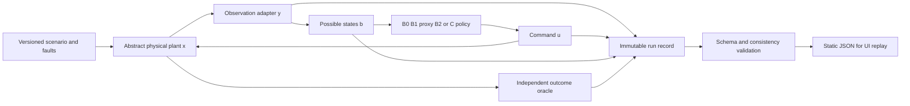

# ADR 001 Interrupted exchange observability before controller complexity

Date: 16 November 2026. Owner: research. Decision: adopted for this local block,
before code. Scientific status: exploratory; not operator acceptance of hardware.
Inputs: [audit](../current-state.md), [primary sources](../sources.md), v3 and the
active engineering prompt. Supersedes no original source or presentation.

## Decision and alternatives

Prioritize (1) traceable requirements and state distinctions, (2) a static v1 UI
contract, (3) a small deterministic hybrid verification model, and (4) only then
a mission-specific comparison. There is no justified product stack or spacecraft
architecture yet. The strongest opportunity presently is to identify which
physical information or design change an existing recovery procedure actually
needs. A standalone software product remains unproven.

| Alternative | Decision and reason |
|---|---|
| New universal connector or complete servicing spacecraft | Defer: established interface heritage, unresolved owner need and qualification burden |
| Contact-seeking probabilistic planner or learned controller | Defer: prior art is strong; no calibrated distributions, contact geometry or safe probe envelope |
| Conventional state machine with explicit recovery | Retain as B0; equal observation quality and action availability |
| Operator-assisted recovery | Retain as B1; a scripted proxy may verify interfaces but cannot measure human performance |
| Independent sensor / passive interlock / removable tool | Retain as B2 system alternatives; independence and whole-system cost must be tested |
| Conservative set of possible states | Select as C's first representation; transparent unknowns without invented probabilities |
| Static JSON plus Python standard library model | Select: readable, offline replay, no dependency install or server needed; use already-installed `jsonschema` for contract checks, recorded in the backend's verification manifest |
| Database, API service, ROS, heavyweight contact engine, sibling tooling reuse | Defer until an actual model or UI requirement warrants the resource and maintenance cost |

## Physical and software boundaries

One fixed host, prepared dummy cartridge and retained transfer support. The first
kernel covers a remove-and-return cycle and interruption at recapture, not a
functional replacement mission. Latch, support, connection, source isolation and
stored energy are distinct. Contact load and 6-DOF dynamics are outside this
kernel; unexpected contact halts progress and load-limit outcome remains
unmeasured. Physical containment is a later fixture requirement, not hidden credit
for retention in the model. No real actuators or hardware adapters exist here.

The plant owns truth; a sensor adapter owns reports; policies receive reports and
history only. A separate oracle reads truth to score outcomes and never supplies
policy inputs. Actuator structural feasibility is separate from policy safety
guards. The oracle must detect deliberately unsafe scripted actions; otherwise
the evaluator would prove safety by refusing to model hazards.

Research owns `research/`, `backend/`, `contracts/cartan/v1/`. No root package or
setup configuration is needed. UI receives frozen committed contracts plus file
hashes and explicit evidence modes. UI cannot turn a fixture or model trace into
a physical test. Unknown, missing, unmeasured, not applicable and explicit null
are tagged; numeric zero and false remain data. A version breaking this meaning
requires v2 and an adapter.

## Resource and implementation boundary

Operator requests now authorize safe bounded work after explicit decisions.
Implement one local model process using the standard library; contract verification
uses the already-installed `jsonschema` package. No servers, paid jobs or GPU.
At most 100 short scenario runs per invocation; 32 commands per run, 5 seconds
CPU per process and 256 MiB address-space request where supported. Total retained
text/JSON target below 10 MiB; temporary reading material below 250 MiB. No parallel
builds. Fail or narrow rather than remove a limit. Report actual runtime/RSS where
observable and platform limits where unenforceable. No trained-operator experiment
or hardware inference is produced by a proxy.

## Evidence and rejection conditions

The contract can pass consistency checks without validating any science. Model
verification checks nominal transitions, impossible requests, truth/report
separation, stale evidence, restart, faults, unsafe controls and replay.
Performance thresholds, distributions and sample size are not mission-supported;
therefore all model comparisons are exploratory and cannot establish an accepted
safety level. Freeze the local protocol before running it.

Narrow or stop the algorithm branch if equal-information B0 matches C. Prefer the
simpler measurement/interlock if it meets a real requirement at lower lifecycle
burden. Stop model-based engineering conclusions if the possible states or sensor
independence cannot be justified physically. No viable owner need means no product
commitment. Move to a reviewed contained fixture only after the circuit, latch,
support, energy, loads, fault injection and independent truth instrumentation have
explicit limits and authorization. This ADR authorizes none of those operations.
