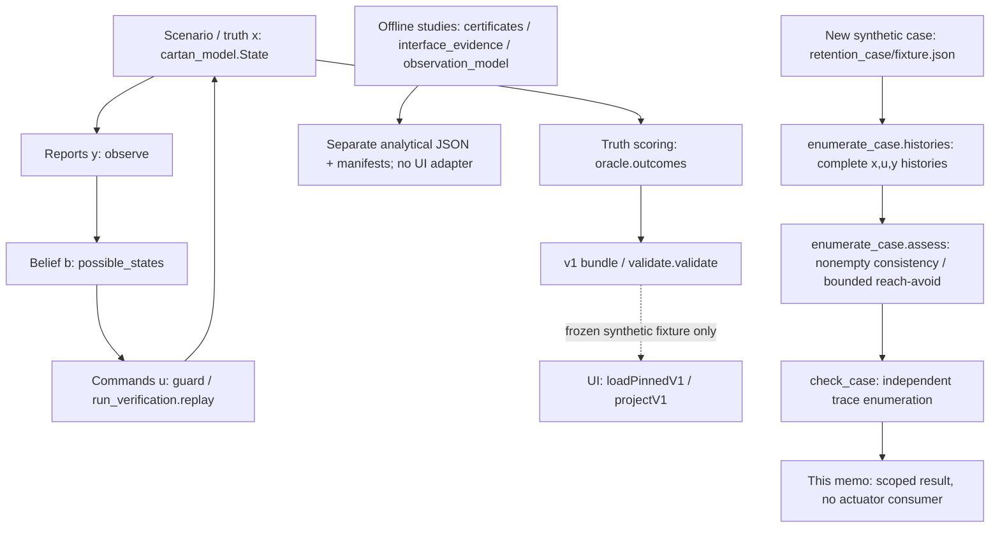

# Interrupted capture: decision memo

23 November 2026. Research owner; civilian prepared-payload servicing only.
Decision record RC-20261123, written after repository reconstruction and primary
method reading, before the new offline fixture. Results are appended after checking.

**Verdict: BASELINE SUFFICIENT within the frozen synthetic case SYN-RC-1.**
Two feasible modeled histories share every ordinary observation and differ in
retention, but the same supported park succeeds in both, and the same ordinary
retry completes the capture-only objective. A separate observer is unnecessary
for these declared endpoints and deadlines. This is a constructed negative result,
not a physical finding. The specification below preceded execution; the final
verdict and results section were completed after the independent check.

No inspected source supplies an identified unit's simultaneous
drive/engagement/load-path truth trace, complete operator-visible history,
applicable restart/interlock behavior and owner-approved support/load/time limits.
A documented design is not such a trace. Whether the physical ambiguity exists,
or changes a permissible mechanical action on real hardware, remains unresolved.

## Reconstruction before edits

Working directory and Git root are
`/Users/danielwahnich/workspace/cartan-worktrees/research`; common directory is
`/Users/danielwahnich/workspace/cartan/.git`. Branch `research/architecture` and
starting HEAD are `04a0ebaffea22929a8e2e20c4857df25f3947acd`. This is also the
merge base with locally recorded `origin/main` at
`940d8f1eaca59d4d785ccb5760af9f1744d24d19`. No network ref freshness is claimed.
The transcript's shortened hash is a discovery anchor, not a verified full SHA.

The sole tracked dirty file was setup-owned `config/environment.json`, pinning
the existing origin and published state. No untracked nonignored file was present.
Setup is at `70456b0`, UI at `dcc8d8e`; each also has a dirty environment config.
The integration worktree at `/private/tmp/cartan-main-integration-20261116` has a
prunable registration pointing at absent storage. Nothing was pruned or reset.
The local main commit's handoff records the later UI integration; its scientific
tree matches research. Thus the research handoff's pending `a75f1d6` integration
is historical. Website claims and frontend checks were not revalidated here.

All 228 tracked paths were inventoried by subsystem: backend 24, contracts 5,
frontend 61, research 66, docs 44, memory 12, scripts 3, configuration 5 and eight
root files. The architecture, not generated file volume, determines this block's
boundary.

| Subsystem and inspected anchors | Ownership, callers/consumers and failure paths |
|---|---|
| `backend/cartan_model.py`: `State`, `transition`, `observe`, `possible_states`, `guard`; `oracle.py`; `test_model.py`; runner symbols and README | Research. Runner owns the scripted plant, reports, commands and truth scoring. Snapshot candidate sets are not feasible temporal histories. Empty candidates reject actions. Partial latch and false telemetry are constructed controls. |
| `backend/certificates/evidence.py`: `Admission`, `CountingB0`, `PossibleStateC`; `run_study.py`: `compare`, `run`, `verify`; tests, study and receipts | Research. A bounded corruption-budget measurement problem, with a separate numerical certificate study. Not a servicing policy benchmark. Source/hash verification and deterministic cores are separate from physical validity. |
| `backend/interface_evidence/engine.py`: `worlds`, `evaluate`; tests, runner reference, cases and block-3 protocol | Research. Six Boolean propositions; logical worlds can be mechanically unreachable. Reports preserve identity, time, epoch and missing states. ACKs do not bind retention. Empty consistency is explicitly inconsistent. |
| `backend/observation_model/model.py`: `voltage`, `topology`; full runner and tests; cases, dossier, specification, results and receipts | Research. Conditional rational voltage inversion and graph connectivity, with separate conventional references. No mechanical forward model and no calibration. Wrong epoch/missing bounds remain unresolved; malformed inputs reject. |
| `contracts/cartan/v1/{schema,fixture,SHA256SUMS}.json`, `validate.py`: `validate`, `self_test`, `check_manifest` | Frozen at `2a4083a`. Validator checks structure/consistency, not physical authority. Five vendored copies are byte checked, not independently reread as new evidence. |
| `frontend/contract-adapter.mjs`: `loadPinnedV1`, `projectV1`; `app.mjs`, adapter and contract tests | UI-owned consumer; hash-pinned synthetic v1 only. Failure displays unavailable/illustration state. Later analytical outputs have no adapter. No frontend changes or execution. |
| `frontend/release/{build_site,verify_package,verify_deployment,search_console}.py`, publication/QA records | UI-owned release boundary inspected by entry points, imports and call sites. Static packaging and external publication are distinct. No tracked CI workflow, root package manager or build lockfile was found. No release path runs in this block. |
| `scripts/`, `config/`, `.codex/`, `.claude/`, canonical setup records | Setup-owned. Canonical handoff/operations specify operator-selected full access; historical worktree defaults are superseded for launch behavior. No launcher, auth or global-setting mutation. |
| `research/`, `docs/`, `memory/`, licensing and root README | Source/claim/protocol/ADR and retained-output separation. `research/README.md` still names block 2 as latest; block-4 code, results and handoff supersede that navigation text. No broad cleanup is part of this memo. |

Generated material includes retained cores/manifests, QA reports/renders and
frontend media. These were inventoried and relevant manifests verified, not read
byte by byte as scientific arguments. Ignored `.cartan/`, bytecode and
`tmp/pdfs/research-20261123/` existed before this work; the last contains earlier
HOTDOCK downloads. They were preserved. No other session was attached or started.
Process inventory showed active Codex/Node jobs; ownership cannot be inferred from
process names. Installed RAM was 16 GiB, free-memory indicator 34%, disk about
50 GiB available. This block uses sequential small processes, not parallel builds.



Research owns all new nodes. Support remains secured throughout the new fixture;
no release, disconnection, approach or electrical transition exists. Truth never
selects a policy action. Identical observed prefixes require identical actions.
Independent checking means different software logic over the same assumptions,
not independent physical truth. Failure of any check stops the local result.

Accessible: requested local instructions, assigned backend prompt, reading list,
audit/v3/source ledgers, research indices, relevant ADRs/specifications, all four
backend paths, frozen contracts and earlier receipts. The two supplied Library
transcripts and full `CARTAN-Codex-Prompt.md` are not exposed by available tools and
were not found in the repository or named local packet. Their contents are not
claimed read. Earlier-session packet/PDF reading is recorded in `current-state.md`;
this session verifies all 12 input hashes but does not relabel all historical
reading or visual QA as newly performed. Current installed-unit data remains absent.

## Source-to-decision record

Sources read on 23 November, with selected method scope below. Same-program
documents are one evidence family. Reported measurements remain the authors'
results. No source establishes the constructed mechanism below.

| Source/revision and inspected method | Demonstrates; rules out; action changed |
|---|---|
| [HOTDOCK D3.7 1.1.0, 25 Aug 2020](https://www.h2020-mosar.eu/wp-content/uploads/2021/08/MOSAR-WP3-D3.7-SA_1.1.0-HOTDOCK-Design-Definition-File.pdf), §§4.1.5, 4.2, 4.6, 4.8; [D2.7 1.0.0, 20 Dec 2019](https://www.h2020-mosar.eu/wp-content/uploads/2020/06/MOSAR-WP2-D2.7-SA_1.0.0-HOTDOCK-User-Manual-.pdf), §5; D2.5 1.1.0 hash verified as the preliminary predecessor | **Design/manual.** ACK, drive position, mechanical coupling and connector deployment have different meanings. Earlier firmware includes stop, power-on initialization, fault recovery and command rejection in fault. D3.7 uses an OBDH pool and changed telemetry grouping. Rules out an ACK-only or no-recovery comparator. Does not establish current freshness, calibration, fault coverage or a defective unit. Keep versions separate; do not implement their packet tables as a driver. |
| [Yüksel et al., ASTRA 2022, PERIOD method](https://doi.org/10.5281/zenodo.7319796), §§3–5, especially Test D | **Methods and reported bench evaluation.** Tests power/control loss during coupling, coupled and decoupling phases, then recovery from an undetermined state. Rules out novelty for interruption testing itself. Obtain the selected unit's actual recovery results before asserting that ordinary recovery fails. |
| [Brinkmann et al., IAC 2022](https://doi.org/10.5281/zenodo.7064066), §4.1.4 and §§5–6 | **Reported bench results.** Counterpart release is evaluated; 376 mechanical cases are reported, with only selected results public. Rules out absence-of-public-detail as evidence of absence. Keep counterpart recovery in a future applicable baseline, outside this mechanical-capture-only artifact. |
| [Space USB, 15 May 2026, DOI 10.3390/engproc2026133194](https://www.mdpi.com/2673-4591/133/1/194) | **Prototype report.** Current page exposes abstract/metadata; current full-text/PDF attempts failed. Earlier full-method reading is attributed to `block-4/source-followup.md`, not freshly reproduced. Do not conflate PERIOD's explicit interruption protocol with a newly verified Space USB interruption result. No detailed coverage claim is made here. |
| [NASA-STD-5017B, 6 Dec 2022](https://standards.nasa.gov/sites/default/files/standards/NASA/B/2022-12-06-NASA-STD-5017B-Approved.pdf), §4.7 DDMR 26, printed p.30, text and page inspected | **Guidance.** Direct indication concerns the function of interest; drivetrain indication can decouple from latch engagement. Rules out treating cam indication as automatically sufficient under unreviewed downstream faults. Require direct engagement evidence and separately qualified capacity/demand. No HOTDOCK failure or compliance conclusion follows. |
| [NASA/SP-20260001900, March 2026](https://ntrs.nasa.gov/citations/20260001900), EVRBP-0009, printed p.16, text and page inspected | **Surface-interface best practice.** Dissimilar confirmation is established guidance, with examples of misleading single-channel indications. Rules out novelty for adding confirmation. It does not qualify an orbital retention mechanism or prove independence merely by counting sensors. |
| [NASA FFR fact sheet](https://www.nasa.gov/wp-content/uploads/2026/05/ffr-nasafactsheet-final.pdf), both pages; printed date not established | **Planned demonstration.** Prepared ORU manipulation and commercial interfaces are a task precedent. Rules out claiming this public analogue is CARTAN's customer, completed flight test or accepted numerical envelope. Retain civilian prepared-payload scope; import no TBR specification. |
| [Ni et al., arXiv:2606.19590v1, 17 Jun 2026](https://arxiv.org/html/2606.19590v1), §§III–V | **Mathematical method with author-reported experiments.** Consistency requires one trajectory satisfying the entire sampled history. Outer-set overlap does not supply a joint witness, and zero overlap volume is not necessarily empty intersection. Use explicit finite histories and a separate checker, not an optimizer score or claimed new theorem. |
| [Dong, Yin and Li, IEEE TAC 69(1), Jan 2024](https://xiangyin.sjtu.edu.cn/Paper/24TACltl.pdf), definitions 3–4 and uniform-bound discussion | **Theory.** Sensor assumptions constrain diagnosability; eventual observation does not supply a uniform deadline. Rules out inferring timely recovery from eventual distinguishability. Freeze the finite horizon and full observation relation. No LTL implementation is needed. |
| [Schreiber et al., arXiv:2605.09158v1, 9 May 2026](https://arxiv.org/html/2605.09158v1), §§II–III | **Probabilistic scheduling method.** Priors, action likelihoods and recovery/lethality durations are model inputs. None is calibrated for this case. Defer probabilistic scheduling rather than invent these quantities. |
| [Heger and Singh, ICRA 2010](https://publications.ri.cmu.edu/storage/publications/pub_files/2010/5/HegerICRA2010.pdf), approach and experimental/recovery passages | **Constructed simulation and operator assistance.** Retry, repair, replanning and escalation are established comparators. Rules out a helpless B0. No injected simulation rate becomes a spacecraft fault rate. CMU is a method benchmark, not affiliation. |

The original interface dossier remains
`backend/observation_model/interface-profile.json`:
`hotdock-public-ddf-2020-observation-dossier/1.0.0`. Its missing cam-to-engagement
map, downstream fault coverage, capacity/demand, support reference and owner limits
are still missing. Voltage at a particular point/time does not prove isolation;
neither quantity participates in this mechanical fixture. Richer belief-space,
hybrid/contact methods and subsystem requalification are later hypotheses only.

## Frozen synthetic case and check design

Choose **SYN-RC-1**, an explicitly invented, fixed civilian bench mechanism with
external support secured. A command receipt at tick 0 is followed by drive motion
at tick 1. A downstream seating stage is due at tick 2 or 3. The sole interruption
occurs at tick 2, after a due-at-2 stage may seat but before due-at-3 completion;
it arrests further movement. A restart at tick 3 changes controller epoch 0 to 1
without changing mechanics. Ordinary readback at tick 4 measures the drive, not
engagement. This delayed-stage/arrest relation is a synthetic assumption, not a
HOTDOCK mechanism description or a demonstrated physical fault.

Truth owns drive coordinate, engagement and retained path separately. For this
finite fixture only, retained path equals seated engagement under an assumed
adequate load capacity. Support is a separate passive retained path, contact is
aligned, controller mode/epoch are explicit, isolation is UNKNOWN and voltage is
UNMEASURED. All real capacities, demanded loads, timing limits and fault bounds
are UNKNOWN. No electrical predicate follows from controller restart.

One persistent bias beta in {0,1} applies to the entire drive trace; it cannot
change independently between samples or across reset. Histories contain the
same commands, timestamps, epoch transitions, drive, support, contact, proximity
and controller reports for both seating branches. Initial drive readback fixes
beta in the chosen history. No omitted independent engagement measurement is
quietly given to C. A direct downstream engagement channel is a separately
declared ideal control, independent of drive bias in this synthetic model only;
its physical independence and load-path mapping remain unproved.

Ordinary B0 first stops motion, keeps support and checks epoch/readback. Fresh
drive rereads do not measure downstream engagement in this fixture. Restart is
not a mechanical repair. A bounded retry completes the delayed seating in two
ticks in either branch, under the explicit one-interruption/no-further-fault
assumption. An alternative supported park takes two ticks and ends in
`supported_abort`. Neither branch loses support. No baseline is denied these
actions. The same information/action/time envelope applies to an explicit observer
and to an ideal competent operator; no human performance is measured.

The post-readback horizon is three synthetic ticks, not seconds or an approved
hold time. Actions: hold, reread, restart and optional direct inspection cost one
tick; retry and park cost two; `attest_capture` costs one and requires retained
engagement. Attestation records a `captured_supported` terminal state; it moves
nothing and never permits release. Park yields a distinct terminal abort, not
recovery. Hold is nonterminal. Primary goal admits either terminal, while a
separate capture-only control requires `captured_supported`. Deadline-one is a
negative control, not an operational urgency claim.

For nonempty complete-history consistency set B, an action is admissible when
its declared guard holds for every member, refuted when none satisfy it, and
unresolved otherwise. Empty B is inconsistent and has no continuation. Reach–avoid
is a different result: every possible branch must remain within the declared
support/contact invariant and reach the stated terminal set by the deadline.
At zero remaining time only an already reached terminal succeeds. At positive
time an action succeeds only if its guard holds throughout B, its duration fits,
and every nonempty successor observation class succeeds recursively. All durations
are positive. This is exact for the finite declared model; it is not a new planner.

Before running, freeze `backend/retention_case/fixture.json`, `enumerate_case.py`
and `check_case.py`. The producer enumerates histories and evaluates the small
recurrence. The distinct checker independently constructs trajectories from
closed-form timing, enumerates all individually admissible action strings through
the horizon and pairs them only when common observation prefixes choose the same
action. Because the plant is deterministic after the selected initial branch,
these consistent pairs exhaust deterministic output-feedback policies on that
finite initial set. Randomization cannot supply a universal guarantee missing
from every deterministic choice. Neither checker nor producer imports the old
models or calls hardware.

Required controls: C01 passive sequencing makes the unretained reported-endpoint
branch impossible; C02 delayed old-epoch delivery is not a new sample; C03
overlapping scalar marginals with no joint persistent-bias witness; C04 common
retry/park under equal information; C05 direct engagement observation; C06 no
certified terminal continuation at deadline one. C00 is the base feasible pair.
The artifact will retain the simpler baseline result even if ambiguity survives.

Bound: Python standard library, one CPU process at a time, five CPU seconds per
invocation, at most four source histories, two consistent branches, horizon three,
seven actions and less than 1 MiB output. A distinct checker rejects changes to
the frozen finite domain. No solver, new dependency, service, model session or
physical action. Existing evidence files and all other lanes remain untouched.

## Verification and final disposition

Fresh pre-implementation verification reproduced observation-v1 and certificate-v1
cores byte for byte, with identical recorded input hashes. The observation,
certificate and interface suites passed 11, 12 and 11 tests respectively. Frozen
v1 passed its validator and rejected 16 negative controls; all five canonical and
vendor files match `2a4083a`. All eight retained output manifests and all 12 packet
file hashes/sizes match. The 42 histories / 186 prefixes remain a bounded binary
corruption-budget tie. Block 4 remains 34 constructed cases, including seven
rejections, eight voltage comparisons and 269 graph assignments. Neither is a
physical retention experiment. No evidence bytes were rewritten.

The independently checked result contains four complete ordinary histories and
four interlock-control histories. The chosen ordinary history retains exactly
`due-2-bias-0` and `due-3-bias-0`. Their common observed drive sequence is
`[0,1,1,1,1]`; commands are capture receipt, drive, interrupt, restart, reread;
epochs are `[0,0,0,1,1]`. Both have secured support and aligned contact throughout.
The first history has engagement/retention `[false,false,true,true,true]`, the
second `[false,false,false,false,false]`. Each uses beta=0 for all samples; the
alternative beta=1 histories fail the initial observation and are not mixed into
later samples. These are joint witnesses under the frozen causal model.

| Control | Checked result and decision consequence |
|---|---|
| C00, common history | Retention unresolved. Attestation is admissible with known retention, refuted with known nonretention, unresolved on their common history. Support-preserving actions remain admissible. No forced choice between incompatible mechanical recovery actions is established. |
| C01, passive sequencing | Only `due-2-bias-0` can produce the reported endpoint under the ideal mechanical constraint. Ordinary readback suffices; do not retain the eliminated branch to manufacture ambiguity. |
| C02, old delivery | The tick-0 drive reading arrives again at tick 4 in epoch 0, after epoch-1 restart. It is a feasible historical duplicate in both branches, not a new acquisition or confirmation. Both remain possible. |
| C03, marginals | The retained relation is `{00,11}` and unretained relation `{01,10}`, each with one persistent beta. Both scalar intersections are `{0,1}`, but full-history intersection is empty. No joint ambiguity witness exists for this mathematical control. Empty consistency returns inconsistent and zero permitted continuations. |
| C04, common B0 action | `park` reaches supported abort in two ticks for either branch. `retry; attest_capture` reaches captured-supported in three ticks for either branch. Same commands, information and time; no observer advantage. A one-tick hold is only an intermediate action, never a terminal recovery. |
| C05, direct observation | Ideal downstream engagement read splits the set into `{false}` or `{true}`. Attestation becomes refuted or admissible accordingly. This changes information, not algorithm quality. It is unnecessary for the common B0 endpoints in C04. |
| C06, deadline one | No universal terminal continuation. The checker considers all seven one-action words per initial branch; there are zero safe terminal paths from the unretained branch and one from the retained branch. Thus no common policy can satisfy the declared goal. This says nothing about real deadlines or physical unrecoverability. |

The independent checker enumerated 258 action words per branch for C00/C04 and
399 for C05, including words rejected for duration/guards/nonterminal outcome.
After that exhaustive filtering, it checked 90, 14 and 162 terminal-trajectory
combinations respectively for a consistent output-history policy. C01 checked
six words; C06 seven. Its winning first-action sets match the recurrence in every
case. The checker shares the finite assumptions but imports none of the producer
logic. No incomplete search or solver success flag is used as a proof.

All seven controls passed. Eight additional corrupted-output checks were rejected:
invented retention, bias changed within a trace, wrong reset epoch, stale delivery
fabricating certainty, marginal overlap passed off as a full witness, empty-set
permission, a false deadline certificate and a truth-selected first action.
A second producer invocation emitted identical bytes. No unexpected test failed.

The distinction matters: `attest_capture` is bookkeeping inside this fixture,
not load transfer or disconnection. The useful physical counterexample requested
by CARTAN has not been established merely by finding a pair of labels. A real
next-action claim requires the missing mechanism-specific permissions and limits.
Likewise, retry and passive park are explicit synthetic guarantees, not procedures
verified on a HOTDOCK unit. Removing either assumption requires a new version,
not silently making B0 weaker in this result.

Smallest information change: one independently calibrated downstream engagement
reading could distinguish this pair. It would still need a qualified relation
between engagement, load capacity and demanded load. Smallest passive change:
the ideal sequencing constraint in C01 prevents the same endpoint with no
engagement. Its actual feasibility, fault coverage, mass/power and integration
cost are unknown. The next physical evidence is a synchronized reference trace
on one identified mechanical/firmware revision, with ordinary diagnostics enabled,
plus restart persistence/interlock documentation and owner-reviewed support/load
limits. There is no authority here to collect it through hardware or outreach.

Reproduce from the research root with Python 3.11+ and no installation. Each
Python invocation sets a five-second CPU limit; use a new temporary directory:

```sh
run_dir=$(mktemp -d /private/tmp/cartan-retention-XXXXXX)
python3 -B backend/retention_case/enumerate_case.py > "$run_dir/result.json"
python3 -B backend/retention_case/check_case.py "$run_dir/result.json"
python3 -B backend/retention_case/enumerate_case.py > "$run_dir/replay.json"
cmp "$run_dir/result.json" "$run_dir/replay.json"
```

Exact executed checker IDs are `RC-enumeration/1.0.0` and
`RC-independent/1.0.0`; scenario `SYN-RC-1`, controls C00–C06. Artifact anchors:
[fixture](../../backend/retention_case/fixture.json),
[enumerator](../../backend/retention_case/enumerate_case.py) and
[distinct checker](../../backend/retention_case/check_case.py).
The original model/test anchors remain
[observation model](../../backend/observation_model/model.py),
[observation tests](../../backend/observation_model/test_model.py),
[report estimators](../../backend/certificates/evidence.py),
[certificate tests](../../backend/certificates/test_certificates.py),
[interface evaluator](../../backend/interface_evidence/engine.py) and
[interface tests](../../backend/interface_evidence/test_engine.py).

| Frozen file / generated result | SHA-256 |
|---|---|
| `fixture.json` | `aca1dc8c228a304b82381c6f9c59de409c42b3880a8781bd8d432f9891b059d7` |
| `enumerate_case.py` | `06716de5963f7f1fcca7cef32cdb60927d2d9a48f0c354ef55314913759e9710` |
| `check_case.py` | `681cc782eca4dbbf237c28c5d03f36425eef4a72f6a13ef75ca6a166f056251e` |
| producer result/replay, 32,065 bytes | `f32db1581a8d0e335a75870b6f943058b92ca021e29ef1d4a776b5c6a0850c72` |

Actual command arrays, stdout/stderr, freeze hashes, corrupted controls and
download receipts are in the session's unique scratch directory
`/var/folders/fl/_txhnxc90xl00n3xtq0r4nq40000gn/T/cartan-retention-20261123-mk0s1467/`.
Earlier-study recheck logs are in
`/var/folders/fl/_txhnxc90xl00n3xtq0r4nq40000gn/T/cartan-retention-recheck-20261123-6eenso_u/`.
These are disposable local records; the three source files and this memo are
the durable reproduction path. No existing `research/evidence/` file changed.
Source PDFs remain outside Git. Key newly retrieved hashes:
NASA SP `fee6644426a6db1a72984d7ec2224288899582b03f04dae7b041a01b4eacffb8`;
NASA 5017B `9fc0210ae0ecc656f8ceadf7b6a5243b3760db0b805e55b3b3e6d1a634866ac4`;
PERIOD method `18db054d008c9760532c98563e5ea93afaa2200d7bd84a40a3de5384936c310f`;
PERIOD mechanical `5bdb1cfdf26a15221b8da7608bd5a25f35685ffc0e620e2c2d3eeabf46110306`.
HOTDOCK D3.7 and D2.7 scratch files match the hashes in the earlier source ledger.

Producer, checker and replay took approximately 0.034, 0.034 and 0.030 seconds
end-to-end wall time, measured by their parent process. Child CPU was 0.029,
0.030 and 0.027 seconds. No per-process memory cap or RSS measurement is claimed
for this new artifact; the enumeration and output bounds are explicit. The three
artifact files total 20,075 bytes. Source downloads were sequential and stayed
below the declared 40 MiB bound; the large NASA PDF required direct retrieval
after the web parser rejected its size. Space USB PDF retrieval returned 403,
and its current web view supplied only abstract/metadata. These limits are retained.

Not run: hardware calibration or fault injection, human/operator trials, comparative
physical performance, flight qualification, richer planning/contact simulation,
frontend/browser/release/SEO/DNS checks, setup regressions, or new full block-1/3
runner replays. No remote mutation, deployment, new dependency or outreach occurred.
The synthetic baseline result is preserved; further planner work is not justified
by this case.
